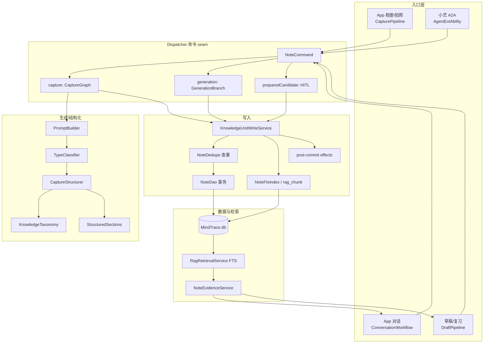

# Agent 链路现状与优化路线（2026-11-01）

> 范围：App 内相册/拍照整理、App 对话、小艺端A2A（文本/OCR/聊天）、笔记生成（草稿/确认）。
> 数据来源：本仓库代码 + 2026-10-31/11-01 真机 e2e（设备 3XTYD24C16203663，MRO-W00 / HarmonyOS 7.0.0）。

## 1. 总览图（当前架构）

```
┌──────────────────────────────── 入口层（4 条）────────────────────────────────┐
│ ① App 相册/拍照              ② App 对话（浮窗）        ③ 小艺 端A2A（扩展进程）   │
│ CapturePipeline              ConversationWorkflow      AgentExtAbility           │
│  previewCaptureSet            · memory / learner         ├─ A2AIntentRouter      │
│  CaptureSetConfirmOverlay       profile / evidence       ├─ A2APlanStore(计划)   │
│  commitCaptureSet              · ReplyService            ├─ OCR(planItems)       │
│                                                          ├─ AgentIngestService  │
│                                                          └─ AgentInboxQueue     │
│ ④ 草稿生成/复习                                                               │
│ DraftPipeline（confirm→HITL v18）                                             │
└───────────────┬─────────────────────┬──────────────────────┬──────────────────┘
                │                     │                      │
                ▼                     ▼                      ▼
        ┌─────────────── Dispatcher：NoteCommand / NoteOutcome 命令 seam ───────────────┐
        │ branch: capture        → CaptureGraph                                          │
        │   OcrNode → ClassifyNode → StructureNode → TruthCheckNode → PersistNode        │
        │ branch: generation     → GenerationBranch + GenerationEvaluator                │
        │ branch: preparedCandidate（HITL 确认/草稿提交，preflightApproval）              │
        └───────────────────────────────┬───────────────────────────────────────────────┘
                                        ▼
        ┌──────────── 生成/结构化（agents/）───────────────────────────────────────────┐
        │ KnowledgeModel · PromptBuilder · CaptureStructurer · TypeClassifier            │
        │   · 学科归一（KnowledgeTaxonomy → CANONICAL_SUBJECTS）                          │
        │   · 分类（概念/定理/公式/证明题/计算题）                                         │
        │   · 标准表单字段（StructuredSections：五类必填/同义词/顺序/占位值过滤）           │
        └───────────────────────────────┬───────────────────────────────────────────────┘
                                        ▼
        ┌──────────── 写入（entry/）───────────────────────────────────────────────────┐
        │ KnowledgeUnitWriteService                                                     │
        │   · 写前查重（NoteDedupe：归一化 + 二元组相似度，最近 120 条）                   │
        │   · commitKey 幂等（capture-set:<setId>:<fingerprint>）                        │
        │   ├─ NoteDao 事务：knowledge_unit + note_revision                              │
        │   ├─ NoteFtsIndex：note_fts(trigram) + rag_chunk（400 字切块）                  │
        │   └─ post-commit effects（卡片/关系边，5s 超时兜底）                            │
        └───────────────────────────────┬───────────────────────────────────────────────┘
                                        ▼
        ┌──────────── 数据与检索（MindTrace.db）──────────────────────────────────────┐
        │ RAG：NoteEvidenceService.build(query) → RagRetrievalService.search(store)      │
        │        （FTS MATCH ≥3 字 / LIKE fallback）→ citations → evidenceContext        │
        │ 消费方：App 对话（ReplyService）、笔记生成注入（DraftPipeline related notes）    │
        │ 回执：CaptureReceipt；运行事件：run_store / run_event（节点级 timing）          │
        └──────────────────────────────────────────────────────────────────────────────┘
```

Mermaid 版：



## 2. 四条链路现状（含真机耗时）

| 链路 | 流程 | 已有保障 | 真机数据 |
|---|---|---|---|
| App 相册/拍照 | 多选/拍照 → previewCaptureSet（OCR + 切题 + 跨图合并，零落库）→ 确认页逐题勾选 → commitCaptureSet（逐题命令） | 确认页、needsReview 默认不勾、逐题回执、commitKey 幂等、写前查重 | 预览 3.2s / 6 题；提交 74.9–154.6s（6 题，LLM 主导） |
| App 对话 | ConversationWorkflow：memory + learnerProfile + **RAG evidence** → ReplyService | 证据引用校验、降级 fallback | 证据注入 `citations=7 degraded=0 / 20ms` |
| 小艺 A2A | 意图路由（probe/plan_continue/plan_waiting/ocr/pick_card/text_ingest/chat/empty）→ OCR 或文本规划 checkpoint → 「继续/第N题/全部/取消」一题一题入库；chat 走 ReplyService | 计划落盘、回执、队列补跑、`e2e=agentTextPlan/agentImagePlan` | OCR→规划 ~1s；单题入库 8.8–79s；`citations` 无（chat 未接 RAG） |
| 草稿生成/复习 | DraftPipeline 生成 → confirm → HITL v18 审批 → preparedCandidate 提交 | 审批哈希、幂等 commitKey、生成评估 | draft 8.9s / confirm 1.2–1.8s；另一轮 draft 76–80s |

## 3. 已落地的关键设计

- **命令 seam**：所有写入走 `NoteCommand/NoteOutcome`，失败有稳定 code/retriable；
- **CaptureGraph**：OCR → 分类 → 结构化 → 真值检查 → 持久化，节点级 timing 进 run_event；
- **HITL**：确认页/草稿确认 → checkpoint 审批 → 端口写前校验审批哈希（v18）；
- **幂等**：commitKey（同批次重复确认）+ 内容查重（跨批次重复整理）；
- **分类/结构质量**：学科枚举收敛（未知→其他）、标准表单字段、同义词对齐、占位值过滤；
- **RAG**：本机 FTS5（trigram）+ LIKE fallback；证据注入对话、相关笔记注入生成；命中失败回退 note.search；
- **A2A checkpoint**：识别摘要 + 规划（题数/字数/待复核/目录）→ 逐题推进；计划持久化跨轮次。

## 4. 瓶颈与风险（按影响排序）

1. **A2A 聊天没有接 RAG/记忆/画像**（`AgentExtAbility` 的 `ReplyContext` 三个字段为空串）。App 对话有证据注入，小艺里问「我之前记过的极限题」答不出来 —— 同一条 RAG 能力，两个入口体验不一致。
2. **单题结构化延迟波动大（8–80s，LLM 主导）**；A2A 聊天有 35s deadline，但**入库路径没有 deadline**（可跑 70–80s），小艺客户端是否等待未验证；用户反馈「一题一题来」后单题仍可能等很久。
3. **分类 + 结构两次 LLM 调用**（Classify 后再 Structure），可合并/降级；且**没有质量回归集**，「乱分类/内容纰漏」只能靠事后看。
4. **查重是内存比对最近 120 条**，且命中即静默跳过；缺「查看/合并已有笔记」的 UX；跨设备/长期数据可能漏判。
5. **两套 checkpoint**（App 确认页 vs A2A plan）模型/文案重复，后续维护易漂移；`AgentExtAbility` 单文件约 1000 行，意图/计划/回执/快照混在一起。
6. **可观测缺质量维度**：有 run_event 节点耗时，但没有字段完整率、学科分布、重复率、延迟 P50/P95 的汇总面板。
7. 小艺图片通道受客户端限制（不可控）；卡片 fallback 已实现但未真机验收。

## 5. 优化 Backlog（建议顺序）

### P0（体验直接可感）

| # | 事项 | 改动 | 验收 |
|---|---|---|---|
| P0-1 | **A2A 聊天接入 RAG/记忆/画像** | `AgentExtAbility` 构造 `ReplyContext` 前调用 `NoteEvidenceService.build(query)` + `AgentMemoryService` 上下文，与 App 对话同源 | 小艺问「我笔记里的 X」返回带引用回答；e2e 断言 evidenceContext 非空 |
| P0-2 | **延迟治理** | 用 run_event 节点 timing 出基线；A2A 入库加 deadline + 超时降级队列；评估「快速生成路由」（跳过二次评估） | 单题 P95 < 30s（目标值待基线确认）；超时不丢原文（入队） |
| P0-3 | **质量回归集** | 20–30 条真实样本（文本/图片）：期望学科、分类、至少 4 个标准字段；脚本跑分类准确率/字段完整率/重复率 | CI 断言：学科准确率 ≥90%，字段完整率 ≥95%，重复率 0 |

### P1（结构性优化）

| # | 事项 | 收益 |
|---|---|---|
| P1-1 | 分类合并：高置信分类直接作为 structure hint，省一次 LLM；低置信才双调用 | 单题延迟 -2~5s，调用成本下降 |
| P1-2 | 查重升级：schema v20 增加 `content_hash` 列 + 索引；命中返回「查看/合并」而非静默跳过 | O(1) 查重、覆盖全库、UX 更可控 |
| P1-3 | 统一 `NoteWritePlan`：App 确认页 / A2A 计划 / 回执共用一套题项模型与文案 | 少一套状态机，行为一致 |
| P1-4 | 拆分 `AgentExtAbility`：SessionController / IntentDispatcher / AnswerBuilder / InboxBridge | 可读性与可测性 |

### P2（后续）

- 生成侧 RAG 增强（rerank / 向量通道 R5，需 embedding 来源）；
- 小艺卡片 fallback 真机验收 + 图片通道跟踪；
- 旧票：ReviewAgent（plan → ask → grade）、MathVideoAgent 脚本流水线；
- 观测面板：把 run_event timing + 质量指标汇总到一个 `e2e=qualityAudit` 输出。

## 6. 建议下一步

先做 **P0-1（A2A RAG）+ P0-3（质量回归集）**：一个补体验短板，一个把「乱分类/纰漏/重复」变成可量化回归；随后用 run_event 基线做 P0-2 延迟治理（否则不知道优化目标该定多少）。


## 7. P0 执行记录（2026-11-01 下午，真机 3XTYD24C16203663）

### P0-1 ✅ A2A 聊天接入 RAG

- 新增 `A2AChatContext`：复用 `NoteEvidenceService`（FTS 检索 → 证据上下文）注入 `ReplyContext`，证据超时 1.2s 降级；回答后 `sanitizeAnswer` 删除证据外引用。
- 真机 `e2e=agentChatContext`：`citations=1 degraded=0 evidenceChars=349 fakeRefRemoved=1 / 16ms` —— A2A 聊天与 App 对话共用同一条 RAG 证据链。
- 记忆/学习画像依赖会话 ID，A2A 无会话暂留空（P1 再评估）。

### P0-2 延迟基线（已量到）

`e2e=latencyProbe`（单题文本整理）节点耗时：

```
CAPTURE_STAGE capture   0ms
CAPTURE_STAGE classify  3499ms
CAPTURE_STAGE structure 17116ms   ← 主耗时
CAPTURE_STAGE truth_check 1ms
CAPTURE_STAGE persist   1599ms
CAPTURE_TOTAL committed 22253ms
```

历史同链路波动 8–80s（LLM 不稳定）；A2A 聊天有 35s deadline、入库无 deadline。下一步：目标 P95（待多轮采样）→ 快速路由/超时转队列。

### P0-3 质量回归（首次跑出数据 + 发现真 bug）

- 新增 `scripts/quality/note-quality-audit.mjs`：跑 `e2e=noteAudit`，输出笔记数/学科分布/非规范学科/字段填充率/空字段/重复对，支持 `--assert`（CI 用）。
- 首个基线（最近 24 条）：`duplicatePairs=18`（多为历史测试样本；老数据学科存在「数学/初中数学」混用）、`notesWithBlankSections=0`。
- **去重问题已修（2026-11-01 15:36）**：原探针 `same=0 added=2` 暴露「同文本重复整理」；新增**输入指纹幂等层**——`capture-input:<normalized-text-hash>` 作为 commitKey（与批次/时间/LLM 改写无关），派发前查 `note_generation_commit`，命中直接复用已有笔记；`CaptureSet` 的 commitKey 也从 `capture-set:<setId>:<fp>` 改为全局 `capture-input:<fp>`。复验：`e2e=dedupeProbe firstId=secondId same=1 notesBefore=notesAfter added=0 / 7ms`。
- 质量基线（16:37 复跑，最近 24 条）：`fieldFilledRatio=1.0`、`notesWithBlankSections=0`、`duplicatePairs=7`（较上次 18 下降）、非规范学科 8 条（均为**历史数据**里的 `数学`，新写入口已收敛到「其他」）；legacy 数据清理列为后续项。

### P0-4 ✅ App 内 agent 统一意图（本轮新增，回应「App 意图也要改」）

- 新增 [`AppIntentRules.ets`](../../entry/src/main/ets/services/AppIntentRules.ets) + [`AppIntentRouter.ets`](../../entry/src/main/ets/services/AppIntentRouter.ets)：
  - 意图从 2 类（note_generation/chat）扩为 7 类：chat / note_generate / review / note_query / image_explain / image_note / clarify；
  - 规则优先（否定句、复习、查笔记、图片讲解 vs 整理、指代不明）→ 规则未命中才 LLM 兜底 → 置信度 <0.6 转 clarify；
  - **clarify checkpoint**：App 对话新增 `clarify_reply` 节点（「① 讲解 ② 整理成笔记」），不再低置信直接猜。
- `ConversationWorkflow` 接线：文字/图片两处分类统一走 router；意图与来源/置信度写入 state（`appIntent/appIntentSource/appIntentConfidence/appIntentClarify`）并落日志。
- 真机 `e2e=appIntentProbe`：9 条样例全符合预期（存笔记→note_generate、别整理→chat、复习→review、找旧笔记→note_query、图片讲解/整理区分、含糊→clarify、普通问答→llm）。
- 契约测试 `v7-app-intent` 6 条；`agent-gate --all` PASS（pass=1140）。


### B 历史数据清理（2026-11-01 15:45，真机已应用）

- 新增 `LegacyNoteNormalizer`（纯函数）：旧学科「别名归一 → 关键词推断（初中/高数/线代/概率）→ 其他」；重复判定复用 `NoteDedupe`（只清完全一致/高相似，避免误删同题不同稿）。
- 新增 e2e：`legacyCleanupAudit`（dry-run） / `legacyCleanupApply`（应用）。
- 真机结果：扫描 140 条 → **42 条学科归一**（数学→初中数学/高等数学/概率论/其他），删除 0 条（旧「同题不同稿」内容差异大，按保守策略保留），耗时 20.6s。
- 质量报告（升级后指标：内容级重复才算重复）：
  - `nonCanonicalRatio=0`、`fieldFilledRatio=1.0`、`notesWithBlankSections=0`、**`duplicatePairs(内容级)=0`**、`titleDuplicatePairs=7`（同标题不同稿，仅信息展示）。
  - 学科分布（最近 24 条）：初中数学 18 / 数学分析 3 / 其他 2 / 概率论 1。
- 质量脚本修复：日志选取改用 `statSync(mtimeMs)`（原实现按文件大小排序会选错日志）；重复指标拆为「内容级（可执行）+ 标题级（信息）」。
